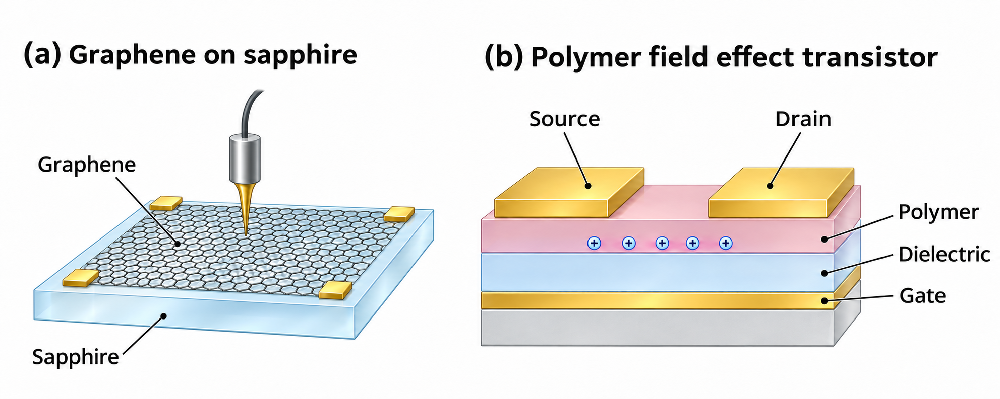

# Electrical characterisation of a graphene wafer

QXU6028 Polymer Devices | Academic year 2026-27

Group number:

Student names and IDs:

## Context and aim

The supplied graphene-on-sapphire dataset is used to estimate carrier density, identify a transport model and assess wafer uniformity. Each result depends on a different part of the measurement model: the carrier-counting convention in L1, the density of states in L2 and the spatial sensitivity matrix in L3. These assumptions matter when deciding how to calibrate a sensor or accept a wafer for device fabrication. Figure 1 shows the material system and the polymer transistor considered in the Transfer section.

The analysis follows the practical methods guide [1] and uses the original regular-data files, verified against their supplied hashes. The regular wafer requires a mobility correction factor of 2.3232, favours the cone model and passes the announced 3.0% uniformity criterion. The following sections examine the evidence and limits of those findings. The submitted blind-test results are retained separately.

*Figure 1. Graphene on sapphire and a bottom-gate, top-contact polymer OFET. The probe denotes electrical characterisation; dimensions and layer thicknesses are schematic. The AI-generated illustration was checked against the lecture device structure [5].*

## L1 Carrier counting and mobility

The band-edge and Fermi-referenced counts integrate the same function, $cE f(E)$, from 0 and $E_F$, respectively, to 2.5 eV. Here $f(E)$ is the Fermi-Dirac occupation. We used $N_A = 3.816 \times 10^{15}$ atoms per square centimetre, $k_B = 8.617333 \times 10^{-5}$ eV/K, $T = 300$ K and $c = 0.0371542\,\mathrm{states}\,\mathrm{atom}^{-1}\,\mathrm{eV}^{-2}$ [1,2]. Each integral used 20,001 trapezoidal points. The independent closed-form check was $n_F = N_A c k_B T[E_F\ln 2+(\pi^2/12)k_B T]$.

At the exact operating energy in the metadata, $E_F = 0.0878123$ eV, the two counts are $n_B = 6.99353 \times 10^{11}$ and $n_F = 3.01029 \times 10^{11}$ $\mathrm{cm}^{-2}$. Thus $C = n_B/n_F = 2.32321$. Using the supplied sheet resistance of 581.9396 ohms per square in $\mu = 1/(en\rho)$ gives $\mu_B = 15{,}336$ and $\mu_F = 35{,}629$ $\mathrm{cm}^{2}\,\mathrm{V}^{-1}\,\mathrm{s}^{-1}$. The change comes entirely from the population used to extract mobility; the resistance is unchanged, and no change in scattering has been measured.

*Figure 2. Carrier counts and their ratio across the supplied sweep. Circles show the supplied band-edge counts and the corresponding calculated ratios. The star marks the exact operating energy. The labelled crossings were found numerically.*

At neutrality, the integration limits coincide and $C = 1$. As positive doping increases, the band-edge integral includes progressively more occupied states below $E_F$. The Fermi-referenced integral samples states above $E_F$. Their leading high-energy dependences are quadratic and linear in $E_F$, respectively, which explains the rising ratio in Figure 2b. The crossings $C = 2$ and $C = 4$ occur at 0.072762 and 0.157347 eV. At 0.10 eV, the ratio is 2.59885, consistent with Chapter 3 [2].

Across the sweep, the numerical Fermi count agrees with the closed form to within $1.19 \times 10^{-6}$ relative. Doubling the integration grid changes either operating-point count by less than $1.92 \times 10^{-7}$ relative. These checks bound numerical integration error; the input files provide no experimental uncertainty for $c$, $T$ or $\rho$.

For a sensor obeying $S \propto 1/n$, the Fermi-referenced calculation predicts 2.3232 times the band-edge response at this operating point. This factor is appropriate only when that response law and population definition apply. L2 uses its own electron and hole populations in a two-carrier transport model.

## L2 Density of states and Fermi level

The L2 dataset contains 58 acquisition indices, each with three paired Hall and sheet-resistance readings. We averaged the repeats, identified the signed Hall crossing between indices 28 and 29, then normalised the two channels independently. Every model curve was normalised in the same way. The carrier integrals split at $E_F$; equal electron and hole mobilities give $R_H \propto (p-n)/(p+n)^2$ and $R_s \propto 1/(p+n)$ [1,3].

The library contains the prescribed cone and symmetric hard-gap V models. It uses 4,000 energy points from -2.5 to 2.5 eV, 400 candidate Fermi levels from $-8k_B T$ to $9k_B T$, and gaps from $0.50k_B T$ to $8.00k_B T$ in steps of $0.25k_B T$. Each measured pair is assigned to its nearest model point in normalised two-channel space. A hard gap is selected only when $r_{gap}<0.85r_{cone}$ and $E_g\ge k_B T$ [1].

*Figure 3. Hall and sheet-resistance fits, Fermi levels in acquisition order and signed residuals. The dotted curve is the best hard-gap candidate. Shading shows the pointwise 16-84% interval from 200 paired-repeat resamples.*

The cone RMS residual is 0.0139733. The best hard-gap candidate has $E_g=0.50k_B T$ and RMS 0.0179514, so it fails both selection conditions. The reported model is therefore cone, with $E_g/k_B T=0$. The assigned Fermi level rises overall from -0.08345 to 0.16658 eV. Local irregularities are retained in acquisition order (Figure 3c). Both channels constrain the assignment, although their slowly varying wings provide weaker energy discrimination.

*Figure 4. Signed Hall repeats, model residuals and the selected-gap distribution. The dotted line marks the required residual improvement. All 200 resamples select the cone.*

For each resample, one complete Hall/resistance pair was drawn independently from the three repeats at every index. Normalisation, fitting and model selection were then repeated, using seed 20260923. Across 200 runs, the median gap and its 16-84% interval are 0 and [0, 0] in units of $k_B T$; the hard-gap selection fraction is zero. The widest pointwise Fermi-level interval spans 0.02864 eV.

The zero-width gap interval shows that the classification is stable to the observed repeat scatter under this decision rule. It does not establish an exactly gapless physical material. Thermal smoothing at $k_B T=25.852$ meV and the finite model grid limit the structure that can be resolved. The residuals in Figure 3d retain measurement scatter and discretisation effects. The cone result is consistent with a conducting or sensing layer, but offers no evidence of a thermally robust off-state for switching. Contact behaviour and absolute device performance would require separate measurements.

## L3 Spatial uniformity

The forward matrix $A$ maps 100 pixels to 128 measurements. The pixels form a 10 by 10 grid over a region six probe pitches wide. Three repeated scans give the mean measurement vector and channel-wise noise estimates. The largest absolute row sum of $A$ is $1.67\times10^{-16}$, confirming that a uniform offset is unobservable. Its numerical rank is 92, so additional spatial modes are also unresolved.

We imposed $\mathrm{mean}(m)=0$ and minimised $\lVert Am-\bar d\rVert^2+\eta\lVert Lm\rVert^2$. The matrix $L$ contains all 180 horizontal and vertical nearest-neighbour differences [1,4]. Five strengths were tested: $\eta/\eta_0=0.01,0.1,1,10,100$, where $\eta_0=0.01\lVert A\rVert_2^2/\lVert L\rVert_2^2=0.00133099$.

The regular checkpoint used $\eta=0.01\eta_0=1.33099\times10^{-5}$. The sensitivity calculation supports retaining this choice. Its residual norm, $1.765\times10^{-6}$, is closest among the tested candidates to the estimated noise norm of the mean, $1.209\times10^{-6}$. At $\eta_0$, the residual is $1.101\times10^{-4}$. The solver retains the guide's $10^{-9}$ diagonal stabilisation. The same operator is used for the map, resolution tests and noise propagation.

*Figure 5. Reconstructed relative Hall-conductivity deviations and forward consistency. Circles identify the extrema. Pixel centres span -2.7 to 2.7 probe pitches; row zero is displayed at the top, with positive y upward.*

The map shows a broad gradient. Its positive extremum is +2.7372% at (-1.5, +2.1) probe pitches; the negative extremum is -2.1417% at (-2.7, -2.7). The latter lies on the measurement boundary, so its shape and location are particularly sensitive to the limited field of view. The map mean is zero to numerical precision. L3 is calculated directly from $A$ and the scans. Its connection to L1 and L2 is physical: carrier extraction and transport assumptions determine the meaning of electrical properties, while L3 tests their spatial variation under the supplied forward model.

*Figure 6. Regularisation sensitivity, singular values, the central impulse response and maxima from 500 noise reconstructions. The expected noise norm of the mean uses repeat standard deviations divided by $\sqrt{3}$. The detection calculation uses the repeat standard deviations prescribed in the guide.*

Zero-mean unit features were injected at central and off-centre pixels, forward-projected and reconstructed. Positive-lobe second moments give equivalent FWHM values of 1.6664 and 1.7258 probe pitches. The larger value, 1.7258 pitches, is reported using the guide's fallback for a coarse half-maximum contour. This tests resolution at two positions; it does not establish the same resolution at every boundary.

For detection, 500 independent Gaussian noise vectors were generated from the channel-wise repeat standard deviations using seed 20260924. The 95th percentile of their maximum absolute reconstructed deviations is $\delta_{95}=1.7753\times10^{-5}$, equivalent to 0.001775 percentage points. This estimate covers noise propagated through the selected operator, rather than model error or unresolved structure.

The announced criterion is $a=\max|m|\le0.030$. Here $a=0.0273723$ and $a+\delta_{95}=0.0273900$, so the prescribed rule gives a clear pass. The resulting envelope, 2.7355-2.7390%, lies below 3.0%; all five tested regularisation strengths also give maxima below the threshold. The decision applies to the resolved, zero-mean map. Narrow defects may be smoothed, and the unobservable modes prevent a claim about all physical variations. At fixed operator, increasing noise would increase the detection limit approximately in proportion.

## Transfer to a polymer field effect transistor

A printed polymer OFET provides a specific application (Chapter 7, PDF page 79) [5]. Chapter 3 derives $\mu=1/(en\rho)$ and relates mobility extraction to disorder, traps and contacts (pages 9 and 12) [2]. L1 shows that the assumed carrier population changes inferred mobility. An OFET therefore needs a gate-capacitance and trapping model to relate induced charge to mobile carriers. L2 shows the value of testing a transport model against more than one measured response. In a disordered polymer, localised states and hopping can make mobility depend on gate voltage and temperature [6]. A broadened density of states and traps must replace the ideal graphene cone. Contact voltage drops also matter: gated injection can substantially distort apparent field-effect mobility [7]. L3 is relevant to thickness, morphology and electrode variations that affect channel current and consistency between devices. Mapping those variations requires a transistor-specific sensitivity model. Neither the numerical graphene correction nor the wafer's 3.0% threshold can be adopted without checking the transistor model and circuit requirements.

## Blind test and reproducibility

The confirmed submitted archive records commit 3304d6712795891e062c5bb2786b8455a4c407d8 and a local run on 24 September 2026 at 03:46 UTC. It gives $C=2.26442$, $n_F=3.18560\times10^{11}$ $\mathrm{cm}^{-2}$ and $\mu_F=33{,}804$ $\mathrm{cm}^{2}\,\mathrm{V}^{-1}\,\mathrm{s}^{-1}$. The 43-index series selects a hard gap of $3.25k_B T$. The map maximum is 3.66225%, with a detection limit of 0.027443 percentage points, giving a clear fail. Recalculation from the original blind inputs reproduces the archived result fields. The local log is preserved; the submission timestamp is held by QMplus.

The accompanying reproduce.py validates the input hashes and regenerates the regular results, diagnostics and data figures. The report and additional checks are subsequent work. AI assistance in coding, drafting and illustration is disclosed in the usage log. The error ledger records the contact-topology and uncertainty-interpretation corrections with their evidence. Member attribution and signatures are supplied separately.

## Conclusion

At fixed sheet resistance, the Fermi-referenced carrier count raises the extracted mobility by a factor of 2.3232. Joint Hall and sheet-resistance fitting selects the cone throughout the repeat resampling. The regular wafer passes the announced uniformity criterion, with a maximum reconstructed deviation of 2.7372% and a tested spatial resolution of about 1.73 probe pitches. The blind dataset instead selects a hard gap and fails the spatial criterion. These conclusions remain conditional on the transport models, measured repeat noise and spatial modes resolved by the supplied matrix.

## Critical self assessment

L2 uncertainty is estimated from only three observed repeats and a fixed model library. All resamples select the cone, producing a zero-width gap interval. Renormalising each resample includes the scale variation caused by those repeats, but does not test systematic channel offsets, integration discretisation or alternative density-of-states shapes. More independent repeats and calibrated raw-channel noise would improve the uncertainty estimate. A grid-refinement study and comparisons with broadened or disordered states would test whether the cone remains adequate. These extensions should be reported alongside the prescribed baseline.

L3 validation covers only two impulse positions and Gaussian noise propagated through a fixed operator. It therefore gives limited information about boundary bias or narrow, overlapping defects. This matters because the reconstructed negative extremum lies at the boundary. Injections across the grid, with different widths and amplitudes, would measure how recovery changes with position and estimate missed-feature risk. Additional repeats would improve the noise estimate, while independent probe placements would help test unresolved modes. Until those checks are available, the pass decision should be interpreted as a result for the resolved reconstruction, rather than a guarantee of uniformity at every length scale.

## References

[1] Sun, Y. (2026). QXU6028 Virtual Lab Practical Methods Guide 2026-27, pp. 3-14. Queen Mary Engineering School.

[2] Sun, Y. (2026). QXU6028 Chapter 3 Carrier Counting and Mobility, PDF pp. 4, 6-12. Course lecture slides.

[3] Sun, Y. (2026). QXU6028 Chapter 5 Reading the DoS from Transport. Course lecture slides.

[4] Sun, Y. (2026). QXU6028 Chapter 6 Probe Measurements and Uniformity, PDF pp. 5-12. Course lecture slides.

[5] Sun, Y. (2026). QXU6028 Chapter 7 Display Technologies and Polymer Electronics, PDF pp. 79 and 82. Course lecture slides.

[6] Vissenberg, M. C. J. M. and Matters, M. (1998). Theory of the field-effect mobility in amorphous organic transistors. Physical Review B, 57, 12964-12967. https://doi.org/10.1103/PhysRevB.57.12964

[7] Bittle, E. G., Basham, J. I., Jackson, T. N., Jurchescu, O. D. and Gundlach, D. J. (2016). Mobility overestimation due to gated contacts in organic field-effect transistors. Nature Communications, 7, 10908. https://doi.org/10.1038/ncomms10908
